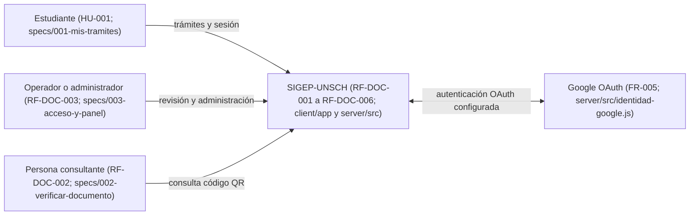

# C4 — Nivel 1: Contexto del sistema

## Resumen

El nivel de contexto presenta SIGEP-UNSCH como un sistema web y las personas o sistemas externos que se relacionan con él. Los enlaces muestran interacciones respaldadas por las historias y rutas actuales, no una topología de despliegue.

## Implementado hoy

### Límites y trazabilidad

- **SIGEP-UNSCH** agrupa el cliente y API del repositorio; el sistema no se dibuja como microservicios.
- **Estudiante** realiza acciones personales de trámite: `specs/001-mis-tramites/spec.md`, necesidades 1–5; evidencia de API en `server/src/solicitudes.js`.
- **Operador o administrador** revisa o administra según rol: `specs/003-acceso-y-panel/spec.md`, FR-001–FR-004; `server/src/revision-grados.js` y `administracion.js`.
- **Persona consultante** usa verificación pública: `specs/002-verificar-documento/spec.md`, FR-001–FR-004; `server/src/verificacion-documentos.js`.
- **Google OAuth** es un sistema externo del flujo condicionado a configuración y vínculo local: `specs/004-login-institucional/spec.md`, FR-005; `server/src/identidad-google.js`.

## Objetivo Sprint 2

No se incluyen aquí capas, caché ni Swagger, pues son objetivos futuros y no actores/sistemas del contexto actual. La eventual publicación/despliegue externo debe confirmarse antes de ampliar el límite del sistema.

## Trazabilidad y fuentes

Especificaciones `specs/001-mis-tramites/spec.md` a `specs/006-banner-autoridades/spec.md`, inventario derivado en `docs/01-analisis-de-sistema/03-requisitos-funcionales.md`, `client/app/`, `server/src/index.js` y rutas en los módulos citados.
