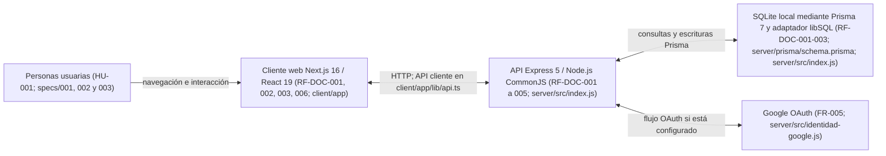

# C4 — Nivel 2: Contenedores

## Resumen

El diagrama muestra las unidades ejecutables/de datos observadas y su comunicación. Cliente, API y persistencia se presentan como contenedores lógicos del repositorio, no como afirmación de que estén desplegados en máquinas separadas.

## Implementado hoy

### Límites y trazabilidad

- **Cliente web**: stack de `client/package.json`; páginas y servicios en `client/app/`. Origen: `specs/001-mis-tramites/spec.md`, `002-verificar-documento`, `003-acceso-y-panel`, `004-login-institucional`, `005-redisenar-secciones-inferiores-home` y `006-banner-autoridades`.
- **API**: aplicación Express compuesta desde `server/src/index.js`; endpoints agrupados por archivos bajo `server/src/`. Origen y mapeo: `docs/01-analisis-de-sistema/03-requisitos-funcionales.md`.
- **Datos**: `server/prisma/schema.prisma` declara `provider = "sqlite"`; `server/src/index.js` acepta `DATABASE_URL` con prefijo `file:` e instancia `PrismaLibSql`. No es PostgreSQL.
- **Google OAuth**: servicio externo referido por `google-auth-library`; flujo de `server/src/identidad-google.js`, conforme a `specs/004-login-institucional/spec.md` FR-005. Su disponibilidad depende de configuración.

Las relaciones indican llamadas/comunicación visibles en el diseño del código; no expresan redes, hosting ni persistencia remota no comprobados.

## Objetivo Sprint 2

Capas internas separadas, caché y Swagger/OpenAPI no se agregan como contenedores actuales. Si se aprueba una arquitectura futura, se documentará por separado antes de implementarla.

## Trazabilidad y fuentes

`client/package.json`, `client/app/lib/api.ts`, estructura de `client/app/`, `server/package.json`, `server/src/index.js`, módulos de `server/src/`, `server/prisma/schema.prisma`, specs `001`–`006` y `docs/01-analisis-de-sistema/03-requisitos-funcionales.md`.
