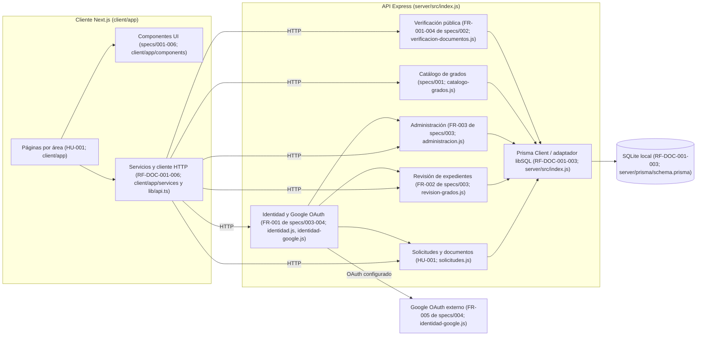

# C4 — Nivel 3: Componentes

## Resumen

El nivel de componentes detalla los módulos visibles dentro del cliente y la API. Cada nodo incorpora su fuente o requisito de origen; los nombres representan archivos/módulos, no servicios desplegados por separado.

## Implementado hoy

### Catálogo de trazabilidad de nodos

| Componente del diagrama | Requisito, historia o escenario de origen | Fuente que acredita existencia |
|---|---|---|
| Páginas por área | HU-001 y necesidades de consulta de `specs/001`; FR-001 de `specs/002` y FR-001 de `specs/003`. | `client/app/` y archivos de páginas. |
| Componentes UI | Escenarios de interfaz de `specs/001`–`006`. | `client/app/components/`. |
| Servicios y cliente HTTP | RF-DOC-001–RF-DOC-006; operaciones frontend. | `client/app/services/`, `client/app/lib/api.ts`. |
| Identidad y OAuth | FR-001/FR-003 de `specs/003` y FR-001–FR-005 de `specs/004`. | `server/src/identidad.js`, `identidad-google.js`. |
| Solicitudes | Necesidades 1–5 de `specs/001`. | `server/src/solicitudes.js`. |
| Revisión | FR-002/FR-004 de `specs/003`. | `server/src/revision-grados.js`. |
| Administración | FR-003/FR-004 de `specs/003`. | `server/src/administracion.js`. |
| Catálogo | Necesidad de iniciar/consultar trámites en `specs/001`. | `server/src/catalogo-grados.js`. |
| Verificación | FR-001–FR-004 de `specs/002`. | `server/src/verificacion-documentos.js`. |
| Prisma/adaptador y SQLite | RF-DOC-001–003, operaciones persistentes. | `server/src/index.js`, `server/prisma/schema.prisma`, `server/package.json`. |
| Google OAuth externo | FR-005 de `specs/004`. | `server/src/identidad-google.js`, dependencia en `server/package.json`. |

Las flechas API representan rutas y llamadas verificables; la dirección entre identidad y routers autenticados refleja el middleware `autenticar` que se pasa al registrarlos. No se dibujan módulos vacíos como componentes.

## Objetivo Sprint 2

No se incluyen repositorios, servicios de aplicación independientes, caché ni capa Swagger como nodos actuales. Podrán añadirse a un diagrama futuro si se implementan y si la documentación se actualiza previamente.

## Trazabilidad y fuentes

Especificaciones `specs/001-mis-tramites/spec.md` a `specs/006-banner-autoridades/spec.md`, `docs/01-analisis-de-sistema/03-requisitos-funcionales.md`, `server/src/index.js` y módulos funcionales citados, `server/prisma/schema.prisma`, `server/package.json` y archivos de `client/app/`.
