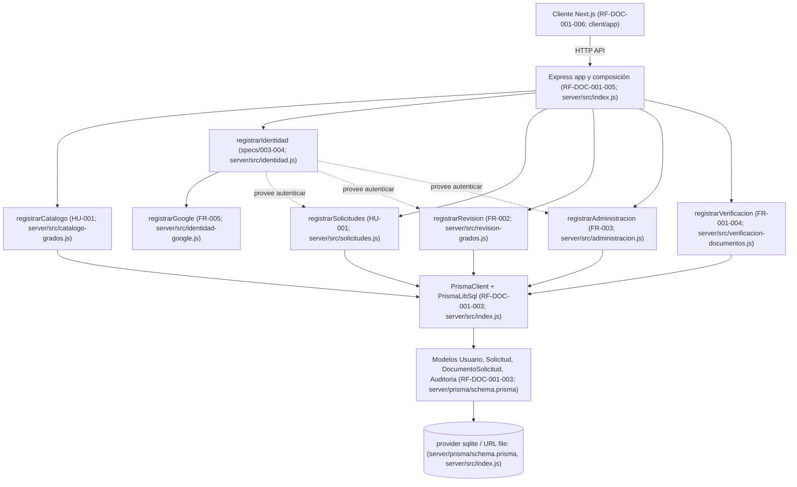

# C4 — Nivel 4: Código

## Resumen

Este nivel muestra la organización de archivos y la composición del servidor, además del enlace hacia el cliente y la persistencia que se puede verificar en el repositorio. Se conserva exactamente el nombre solicitado: `Nivel4-DiagramadeCodigo.md`.

## Implementado hoy

### Elementos, origen y límites

| Elemento representado | RF/HU/escenario de origen | Evidencia del código |
|---|---|---|
| Cliente web | RF-DOC-001–006, derivados de specs `001`–`006`. | `client/app/`, `client/app/lib/api.ts`. |
| Punto de composición Express | Fuente de existencia y escenario de API autenticada (specs `001`, `003`, `004`). | `server/src/index.js`. |
| Catálogo | HU-001, iniciar/consultar un trámite en `specs/001-mis-tramites/spec.md`. | `server/src/catalogo-grados.js`. |
| Identidad local | FR-001 de `specs/003-acceso-y-panel/spec.md`; FR-001–004 de `specs/004-login-institucional/spec.md`. | `server/src/identidad.js`. |
| Identidad Google | FR-005 de `specs/004-login-institucional/spec.md`. | `server/src/identidad-google.js`. |
| Solicitudes | HU-001 y necesidades 2–5 de `specs/001-mis-tramites/spec.md`. | `server/src/solicitudes.js`. |
| Revisión | FR-002 de `specs/003-acceso-y-panel/spec.md`. | `server/src/revision-grados.js`. |
| Administración | FR-003 de `specs/003-acceso-y-panel/spec.md`. | `server/src/administracion.js`. |
| Verificación | FR-001–004 de `specs/002-verificar-documento/spec.md`. | `server/src/verificacion-documentos.js`. |
| Prisma/libSQL | Flujos persistentes RF-DOC-001–003; fuente de existencia/configuración. | `server/src/index.js`, `server/package.json`. |
| Modelos y almacenamiento SQLite | Fuente de existencia del esquema de los flujos anteriores; no implica por sí sola que cada entidad tenga flujo activo. | `server/prisma/schema.prisma`. |

Las flechas continuas representan importación/registro o acceso a persistencia; las punteadas indican que `registrarIdentidad` devuelve `autenticar` y este se entrega a los módulos correspondientes desde `server/src/index.js`. El diagrama no implica que `registrarGoogle` se invoque directamente desde `index.js`: se registra internamente desde identidad.

## Objetivo Sprint 2

No se muestran carpetas/capas inexistentes (`server/src/lib/`, `middleware/`, `routes/`) como unidades actuales, ni repositorios, caché o Swagger. Si el código se reorganiza, este nivel deberá actualizarse con los nuevos archivos después de aprobar el diseño y antes de implementar el cambio arquitectónico.

## Trazabilidad y fuentes

Fuentes primarias: `server/src/index.js`, módulos listados, `server/prisma/schema.prisma`, `server/package.json`, `client/app/` y las especificaciones indicadas por elemento. Requisitos consolidados: `docs/01-analisis-de-sistema/03-requisitos-funcionales.md`; arquitectura de contenedores y componentes: `docs/02-arquitectura-software/arquitectura-inicial.md` y `componentes-arquitectonicos.md`.

### Composición y rutas verificadas (FR-016)

`server/src/index.js` importa los registradores y entrega las dependencias según cada firma. `registrarIdentidad` devuelve `autenticar`; `registrarSolicitudes`, `registrarRevision` y `registrarAdministracion` reciben esa función. `registrarGoogle` se monta desde `identidad.js`. La tabla relaciona cada unidad de código con el inventario HTTP efectivo; los prefijos de `Router` ya están compuestos.

| Unidad de código / origen | Rutas declaradas | Trazabilidad funcional |
|---|---|---|
| `registrarCatalogo(app, prisma, normativa)` — `server/src/catalogo-grados.js` | GET `/api/catalogo-grados/:tramite`; GET `/api/catalogo-grados/:tramite/:programaId` | Consulta para trámites; `specs/001-mis-tramites/spec.md`. |
| `registrarIdentidad(app, prisma, secreto)` — `server/src/identidad.js` | POST `/api/auth/login`; POST `/api/auth/logout`; GET `/api/auth/perfil` | Acceso y sesión; `specs/003-acceso-y-panel/spec.md`, `specs/004-login-institucional/spec.md`. |
| Registro Google desde identidad — `server/src/identidad-google.js` | GET `/api/auth/google/estado`; GET `/api/auth/google/iniciar`; GET `/api/auth/google/callback` | FR-005 de `specs/004-login-institucional/spec.md`. |
| `registrarSolicitudes(app, prisma, autenticar, directorio)` — `server/src/solicitudes.js` | GET y POST `/api/solicitudes/`; POST `/api/solicitudes/:id/presentar`; PUT `/api/solicitudes/:id/documentos/:plantilla`; POST `/api/solicitudes/:id/subsanar`; GET `/api/solicitudes/:id/documentos/:documento` | Necesidades 1–5 de `specs/001-mis-tramites/spec.md`. |
| `registrarRevision(app, prisma, autenticar, directorio)` — `server/src/revision-grados.js` | GET `/api/revision-grados/`; GET `/api/revision-grados/reporte`; GET `/api/revision-grados/:id/documentos/:documento`; POST `/api/revision-grados/:id/acciones` | FR-002 y FR-004 de `specs/003-acceso-y-panel/spec.md`. |
| `registrarAdministracion(app, prisma, autenticar)` — `server/src/administracion.js` | GET `/api/administracion/configuracion`; GET y POST `/api/administracion/programas`; GET `/api/administracion/estudiantes`; GET y POST `/api/administracion/usuarios`; GET y POST `/api/administracion/requisitos`; GET `/api/administracion/auditoria` | FR-003 y FR-004 de `specs/003-acceso-y-panel/spec.md`. |
| `registrarVerificacion(app, prisma, opciones)` — `server/src/verificacion-documentos.js` | GET `/api/documentos/verificar-qr/:codigo` | FR-001–FR-004 de `specs/002-verificar-documento/spec.md`. |

El inventario completo está en `docs/01-analisis-de-sistema/03-requisitos-funcionales.md` (FR-016). El modelo SQLite se acredita por `server/prisma/schema.prisma` y el adaptador por `server/src/index.js`; la mención del esquema no afirma que toda entidad tenga una ruta operativa.